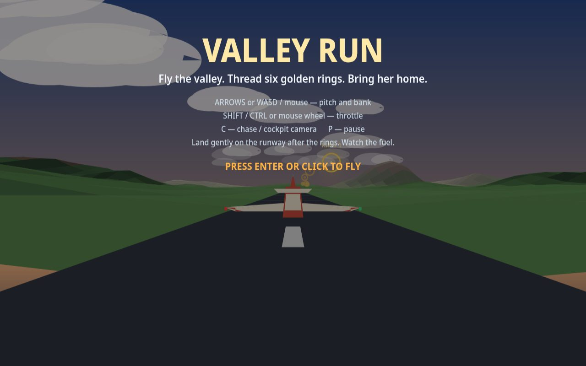

# Valley Run — a flight game

**Valley Run** is an original flight game for the make.fun best-flight-game bounty. It runs in a desktop browser from static files with no network request: a chase/cockpit view over a mountain valley with a river, a runway, and six golden rings to thread before bringing the aircraft home.

## How to play

You fly one sortie: take off from the runway at the mouth of the valley, thread all six golden rings up the valley to the high lake, then turn around and land on the same runway before the fuel runs out.

- **Take off:** hold full throttle (Shift or mouse wheel up) and pull back (Arrow Up / W / mouse up) once past 26 m/s.
- **Fly the rings:** each ring is worth 100 points. The gold guidance marker and the distance readout point at the next one.
- **Land:** after the sixth ring, the marker points at the runway. Come in slow (under 48 m/s), level, and gentle — a hard or sideways arrival is a crash. A good landing scores 500 plus a fuel bonus.
- **Fuel:** the tank lasts roughly two sorties at cruise. Firewalling the throttle the whole way leaves no margin for the trip home.
- **Stall:** below 19 m/s the wing gives up and the nose drops. Keep the speed up on final approach.

### Controls

| Input | Action |
| --- | --- |
| Arrow keys or WASD | Pitch and bank (Up/W climbs) |
| Mouse (move) | Yoke: steer by moving the mouse |
| Shift / Ctrl or mouse wheel | Throttle up / down |
| C | Chase camera / cockpit camera |
| P or Esc | Pause |
| Enter / Space / click | Start, restart |

## Features

- **A real 3D view on a 2D canvas:** perspective projection with a smoothed chase camera and a cockpit camera, over a seeded procedural valley — ridged hills, forest slopes, snow peaks, a river, drifting clouds and a low evening sun.
- **A flyable aircraft in frame:** a red-and-cream prop plane with navigation lights, banked with its roll, plus a cockpit frame and nose in cockpit view.
- **Lit instruments:** altitude, airspeed and heading in big numerals, a compass tape, an attitude ball, an altimeter and an airspeed dial, a heading card, throttle and fuel gauges.
- **Flight model with trade-offs:** throttle sets speed, pitch sets climb, bank turns the aircraft, and a stall below 19 m/s. Fuel burn makes the return leg a decision, not a formality.
- **A complete mission:** six rings, a return leg, a glide-slope landing with a flare, and crash / landing screens with a score breakdown and a best score kept in local storage.
- **Synthesised sound:** ring chimes, a landing fanfare and a crash thud, all built with WebAudio — no audio files, no network.
- **Screenshots:** the four images in `screenshots/` are real renders of this game's own code, staged by `game/src/shots.js` with an autopilot that flies the actual rules (take-off, all six rings, a pattern and a landing).

## Dossier

- **Entrypoint:** `game/index.html` — open it from any static server (`node serve.ts`, then http://localhost:8080). No build step, no libraries, no network requests; every file the page loads lives under `game/`.
- **Source layout (one job per file):**
  - `game/src/main.js` — boot and the fixed-step game loop, screens, pause.
  - `game/src/flight.js` — flight model and mission state (rings, landing, crash, fuel, score).
  - `game/src/terrain.js` — the seeded valley: heightfield, river, runway strip, ring course, clouds.
  - `game/src/render.js` — the 3D view: sky, terrain grid, runway, rings, aircraft, cockpit frame.
  - `game/src/hud.js` — HUD, lit instruments, guidance arrow, title / pause / crash / landing screens.
  - `game/src/input.js` — keyboard and mouse (stick, throttle, camera, pause).
  - `game/src/audio.js` — synthesised WebAudio sounds.
  - `game/src/shots.js` — the screenshot scenes and their autopilot.
  - `game/src/config.js` — every tuning constant in one place.
  - `game/src/random.js` — seeded random and value-noise helpers.
- **Hand-in:** `main.ts` (Node 22, standard library only) copies `game/` and `screenshots/` to `/output` and writes `/output/dossier.json` with the vendored `vendor/makefun-game.ts`, exactly as the kit's starter does. Outside the grader, `MAKEFUN_OUTPUT_DIR=out node main.ts` does the same locally.
- **License:** MIT (`LICENSE`).

## Credits

Original game, art, and code by ichwann12 for the make.fun best-flight-game bounty. No existing game's names, characters, art, music, or levels are used.
